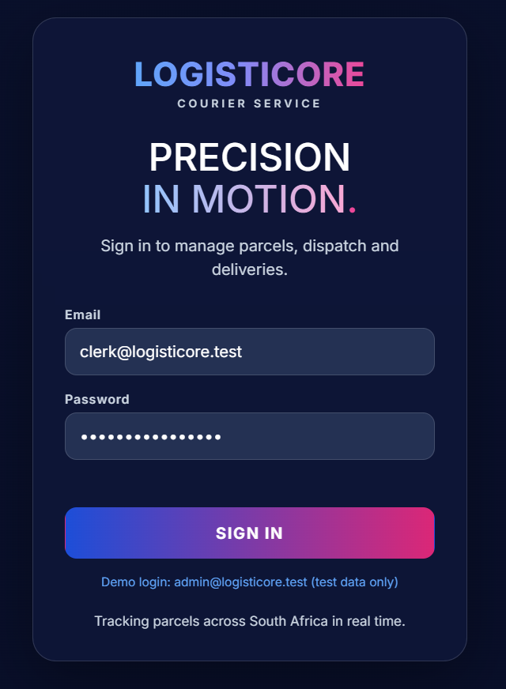
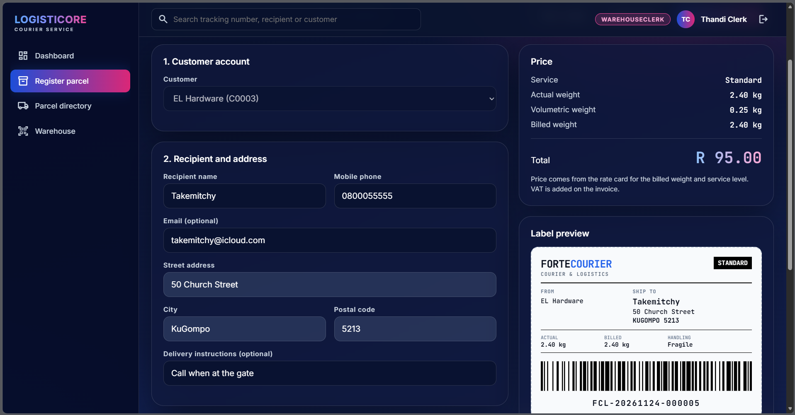
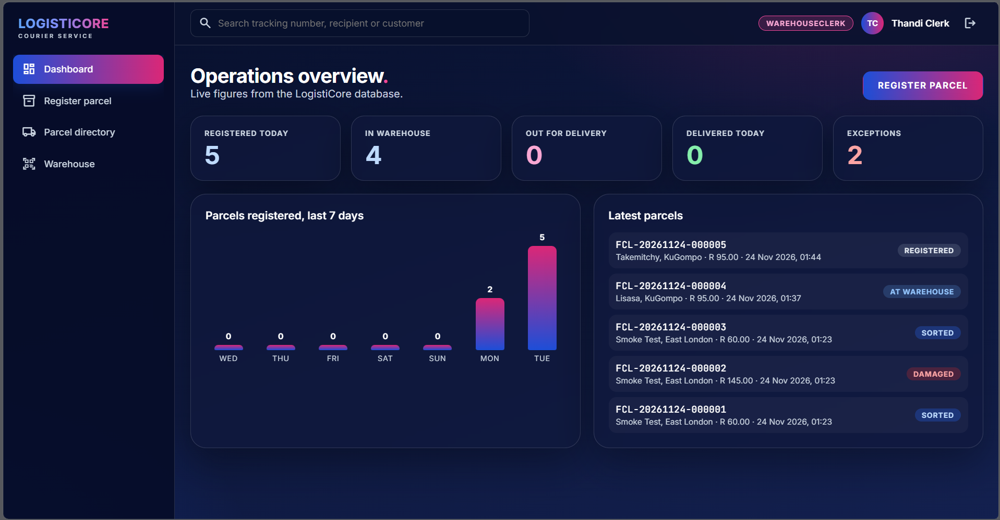
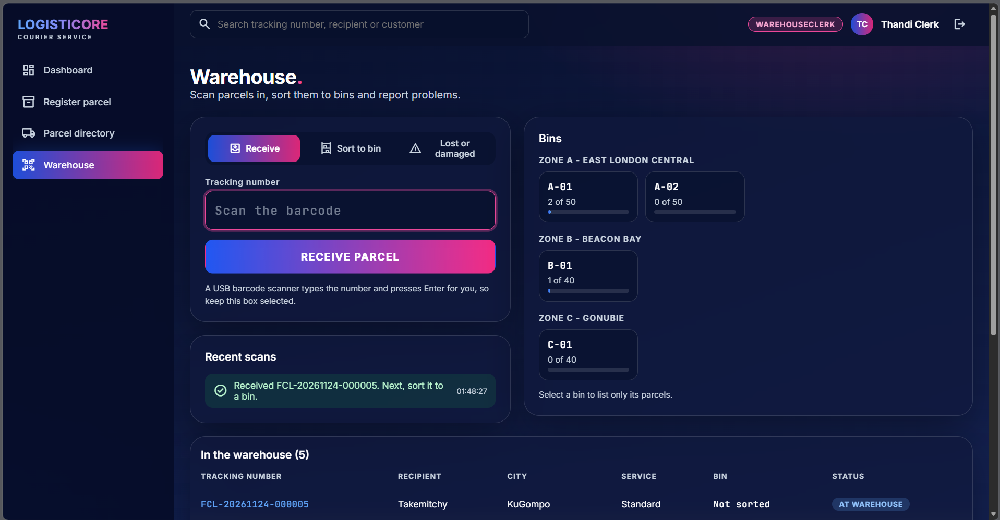
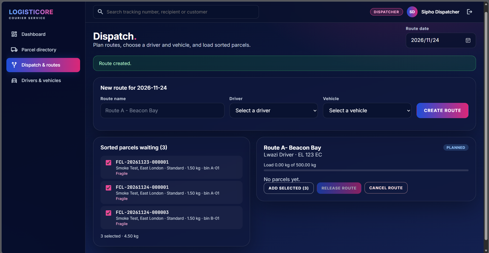
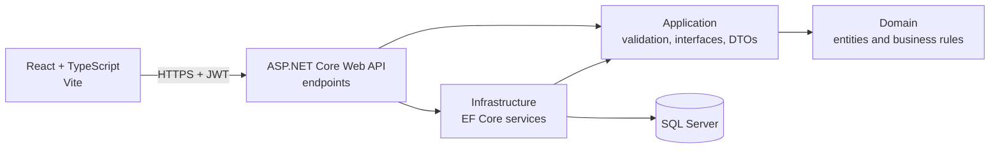

# LogistiCore

**Parcel intake, warehouse sorting, driver dispatch and billing for a courier company.**
Built for Forte Courier & Logistics (FCL), a fictional company, as the capstone project for IFS303E Systems Development Project, BCom Information Systems, University of Fort Hare.

   

    

## The problem
FCL handles parcel intake, warehouse sorting and driver dispatch by hand. Typing errors, lost parcels and late deliveries are common, customers cannot see where their parcels are, and billing is slow.

## The solution
LogistiCore replaces the paper process with one system. A parcel gets a unique tracking number and barcode when it is registered. Every move after that is recorded with who did it and when, from the warehouse shelf to the delivery, and the invoice is built from the deliveries.

## Progress
| Module | Status | What it does |
|---|---|---|
| Authentication and roles | Done | Login with JWT, six roles, every endpoint protected by role |
| A. Parcel registration | Done | Customer, recipient and cargo capture, live price, tracking number, Code128 barcode label, printable |
| A. Parcel directory | Done | Search, filter by status, paging, parcel detail with full status history |
| B. Warehouse | Done | Scan to receive, sort into bins (with capacity), report lost or damaged |
| Dashboard | Done | Live counts and a 7-day chart from the database |
| C. Dispatch and routes | Done | Plan routes by day, assign driver and vehicle, load sorted parcels with capacity and double-booking checks, release or cancel |
| D. Delivery | Next | Driver manifest, proof of delivery, failed attempts |
| E. Notifications | Planned | Customer messages at key status changes, public tracking page |
| F. Billing | Planned | Invoices, monthly statements, payments |
| Reports | Planned | Daily movement, driver performance, monthly revenue, lost and damaged |

## Architecture

| Layer | Project | Responsibility |
|---|---|---|
| Domain | `LogistiCore.Domain` | Entities and pure business rules (pricing, tracking numbers, status path). No dependencies. |
| Application | `LogistiCore.Application` | Request and response models, validation, service interfaces |
| Infrastructure | `LogistiCore.Infrastructure` | Entity Framework Core, the services that talk to SQL Server |
| API | `LogistiCore.Api` | HTTP endpoints, JWT authentication, role authorisation |
| Frontend | `frontend` | React screens, role-based navigation, API client |

## Business rules implemented
1. **Tracking number** `FCL-YYYYMMDD-NNNNNN`, counting up each South African day. A unique index plus a retry stops two clerks getting the same number.
2. **Volumetric weight** = length x width x height (cm) / 5000. The parcel is billed on the larger of actual and volumetric weight.
3. **Price** comes from the rate card for the billed weight and service level. Weights above 30 kg are refused.
4. **Status path**: Registered, At warehouse, Sorted, Assigned, Out for delivery, Delivered. A failed attempt goes back to the warehouse or is returned. Lost or damaged is allowed from any active status. Anything else is refused.
5. **Bin capacity**: a bin cannot hold more parcels than its capacity.
6. **Audit trail**: every status change writes a history row with who, when and a note.

## Security
- Passwords are hashed (ASP.NET Core Identity hasher), never stored as text.
- Login returns a signed JWT with the user's role. Every endpoint checks it.
- A wrong email and a wrong password give the same answer, so attackers learn nothing.
- Secrets (connection string, signing key) live in .NET user-secrets, never in Git.
- CORS only allows the frontend's address.

## Getting started
### You need
.NET 10 SDK, Node.js 20 or newer, SQL Server Express (or any SQL Server) with SQL Server Management Studio, Git.

### 1. Database
In SSMS run these files from `database/`, in order, each once:
`01_schema.sql`, `02_seed.sql`, `03_reports.sql`, `04_parcel_columns.sql`.
This creates the `LogistiCoreDb` database with demo data.

### 2. API
```bash
cd backend/src/LogistiCore.Api
dotnet user-secrets set "ConnectionStrings:Default" "Server=localhost\SQLEXPRESS;Database=LogistiCoreDb;Trusted_Connection=True;TrustServerCertificate=True"
dotnet user-secrets set "Jwt:Key" "<a long random string, at least 32 characters>"
dotnet run
```
The API listens on `http://localhost:5027`. Change the server name in the connection string to match your SQL Server instance.

### 3. Frontend
```bash
cd frontend
npm install
npm run dev
```
Open `http://localhost:5173`.

### Demo accounts
All use the demo password `LogistiCore#2026` (test data only). The first time the API runs in Development it replaces the placeholder password hashes.

| Email | Role |
|---|---|
| admin@logisticore.test | Admin |
| clerk@logisticore.test | WarehouseClerk |
| dispatcher@logisticore.test | Dispatcher |
| driver1@logisticore.test, driver2@logisticore.test | Driver |
| billing@logisticore.test | Billing |

## Testing
```bash
# unit tests for the business rules and validation
dotnet test backend/LogistiCore.slnx

# end-to-end check of the main journey against a running API (PowerShell)
Set-ExecutionPolicy -ExecutionPolicy RemoteSigned -Scope Process
.\scripts\smoke-test.ps1

# frontend type check and build
cd frontend && npm run build
```
The smoke test registers parcels, receives and sorts them, flags a damaged one, and checks prices, security, history and the dashboard.

## Project structure
```
LogistiCore/
  backend/
    src/  LogistiCore.Domain, .Application, .Infrastructure, .Api
    tests/LogistiCore.UnitTests
  frontend/        React + TypeScript (Vite)
  database/        SQL scripts (schema, seed, reports, migrations)
  docs/            Project Initiation Document, requirements, design, API, decisions
  scripts/         smoke-test.ps1
  .github/         CI workflow, issue and pull request templates
```

## Documentation
| Document | |
|---|---|
| [Project Initiation Document](docs/00-project-initiation-document.md) | Problem, scope, stakeholders, risks |
| [Requirements](docs/01-requirements.md) | Functional and non-functional requirements, business rules |
| [Work Breakdown Structure](docs/02-wbs.md) | |
| [Use cases](docs/03-use-cases.md) | Diagrams and narratives |
| [ERD and schema](docs/04-erd-and-schema.md) | |
| [Architecture](docs/05-architecture.md) | |
| [UI and UX design](docs/06-ui-ux-design.md) | Brand and design system |
| [API specification](docs/07-api-spec.md) | |
| [Testing strategy](docs/08-testing-strategy.md) | |
| [Roadmap](docs/09-roadmap.md) | Sprint plan |
| [Team workflow](docs/10-team-workflow.md) | Branching, commits, reviews |
| [Parcels module](docs/12-parcels-module.md), [Warehouse module](docs/13-warehouse-module.md), [Dispatch module](docs/15-dispatch-module.md) | |
| [Design decisions](docs/14-design-decisions.md) | Why the system is built the way it is |

## Development notes
Parts of the code and documentation were produced with AI assistance and reviewed by the team.

## Team
| Name | Role |
|---|---|
| Bathabile Malunga | Project Manager |
| Lelethu Matiwane | Developer |
| Lindani Ishmael Zakwe | UX/UI Designer |
| Makline Sibanda | Business Analyst |
| Sibahle Qongqo | Business Analyst |
| Mihle Dudumashe | Business Analyst |
| Hlumela Ntloko | Business Analyst |

## Licence
MIT
