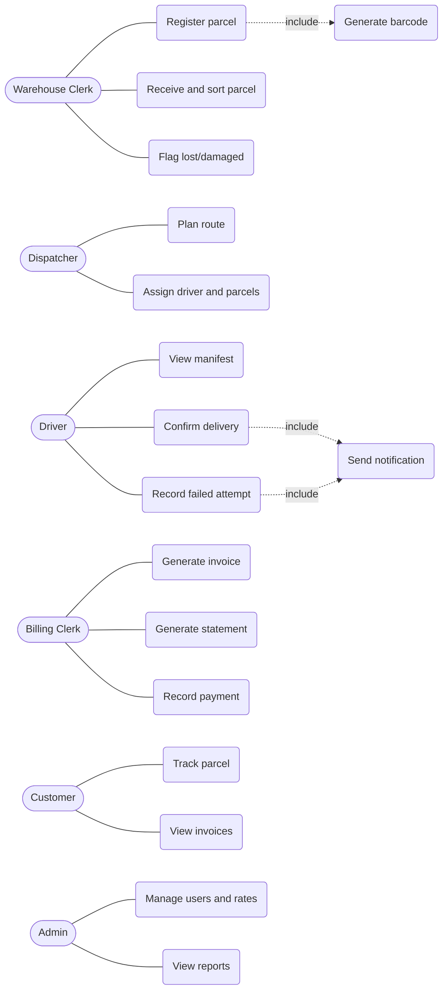
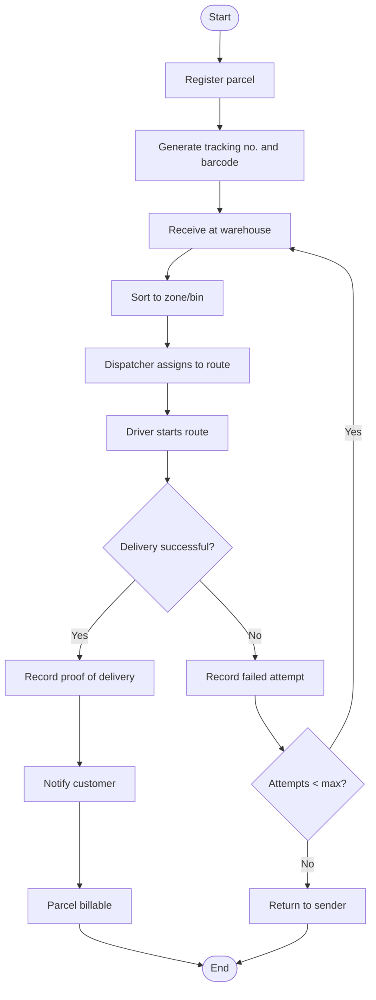
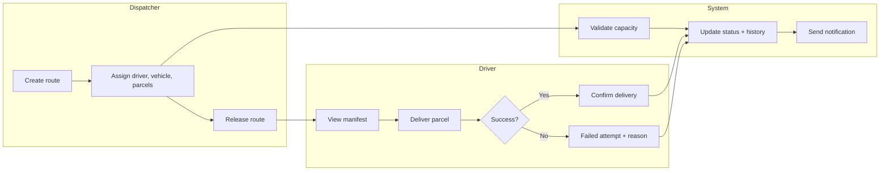

# Use Cases and Activity Diagrams

## Actors
Admin, Dispatcher, Warehouse Clerk, Driver, Billing Clerk, Customer, System (notification service).

## Use case diagram

## Use case index
| ID | Name | Primary actor | Module |
|---|---|---|---|
| UC01 | Register parcel | Warehouse Clerk | A |
| UC02 | Receive and sort parcel | Warehouse Clerk | B |
| UC03 | Flag lost/damaged parcel | Warehouse Clerk | B |
| UC04 | Plan route | Dispatcher | C |
| UC05 | Assign driver and parcels | Dispatcher | C |
| UC06 | View manifest | Driver | C |
| UC07 | Confirm delivery | Driver | D |
| UC08 | Record failed attempt | Driver | D |
| UC09 | Generate invoice | Billing Clerk | F |
| UC10 | Generate monthly statement | Billing Clerk | F |
| UC11 | Record payment | Billing Clerk | F |
| UC12 | Track parcel | Customer | E |
| UC14 | Manage users and rate cards | Admin | Security |
| UC15 | View reports | Admin/Manager | Reports |

## Narrative: UC01 Register parcel
| Field | Detail |
|---|---|
| Primary actor | Warehouse Clerk |
| Goal | Capture a parcel and produce a tracking number and label |
| Preconditions | Clerk logged in; customer exists (or is created inline) |
| Trigger | Customer hands over a parcel |
| Main flow | 1. Clerk selects customer. 2. Enters recipient name, phone, address. 3. Enters weight, dimensions, service level. 4. System validates and calculates price from the rate card. 5. Clerk confirms. 6. System creates parcel with status Registered, generates tracking number and barcode. 7. System writes status history and sends "registered" notification. 8. Clerk prints the label |
| Alternative flows | 4a. Invalid weight/missing field → inline errors, return to step 3. 4b. No rate for the combination → show error, ask Admin to configure |
| Postconditions | Parcel persisted with unique tracking number; history entry created; notification logged |
| Business rules | BR1, BR2 |

## Narrative: UC07 Confirm delivery
| Field | Detail |
|---|---|
| Primary actor | Driver |
| Goal | Record successful delivery |
| Preconditions | Parcel is OutForDelivery and on the driver's active route |
| Main flow | 1. Driver opens manifest. 2. Selects stop/parcel. 3. Chooses "Delivered". 4. Enters recipient name (and notes). 5. System timestamps and saves delivery record. 6. Status becomes Delivered. 7. System sends notification. 8. If all stops complete, route is marked Completed |
| Alternative flows | 3a. "Failed attempt" → UC08 |
| Postconditions | Delivery record exists; parcel billable |

## Narrative: UC05 Assign driver and parcels
| Field | Detail |
|---|---|
| Primary actor | Dispatcher |
| Preconditions | Route exists for the date; parcels are Sorted |
| Main flow | 1. Dispatcher opens the dispatch board. 2. Selects a route. 3. Selects driver and vehicle (only available ones shown). 4. Adds parcels. 5. System checks capacity and double assignment. 6. Dispatcher releases the route. 7. Parcels become Assigned, then OutForDelivery when the driver starts |
| Alternative flows | 5a. Over capacity → warn, block. 5b. Driver already booked → block |

## Narrative: UC09 Generate invoice
| Field | Detail |
|---|---|
| Primary actor | Billing Clerk |
| Main flow | 1. Select customer and period. 2. System lists Delivered, uninvoiced parcels. 3. Clerk reviews. 4. System creates invoice, lines, VAT, total. 5. Parcels are marked invoiced |
| Alternative flows | 2a. No billable parcels → message |

## Activity diagram: parcel lifecycle

## Activity diagram: dispatch and delivery (swimlanes described)

