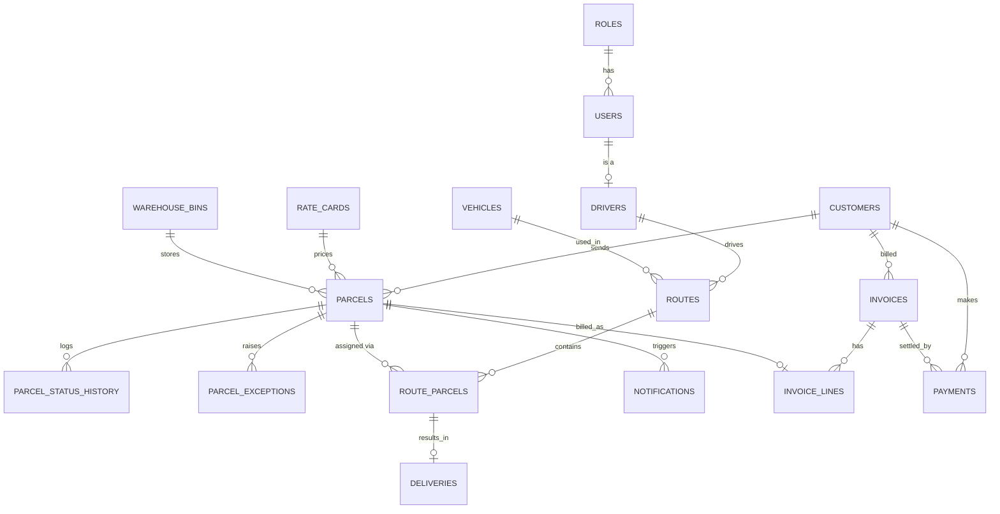

# ERD and Database Schema

Executable script: [`database/01_schema.sql`](../database/01_schema.sql). Seed: `02_seed.sql`. Reports: `03_reports.sql`.

## ERD

## Tables and key attributes
| Table | Purpose | Key attributes |
|---|---|---|
| Roles | Security roles | RoleId, Name |
| Users | Login accounts | UserId, Email, PasswordHash, RoleId, IsActive |
| Customers | Business/individual clients | CustomerId, Name, Email, Phone, BillingAddress, AccountNo, UserId (optional portal login) |
| RateCards | Pricing | RateCardId, ServiceLevel, MinWeightKg, MaxWeightKg, Price |
| WarehouseBins | Storage locations | BinId, Zone, Code, Capacity |
| Parcels | Core entity | ParcelId, TrackingNo, CustomerId, RecipientName, RecipientPhone, DeliveryAddress, WeightKg, ServiceLevel, Price, CurrentStatus, BinId, IsInvoiced |
| ParcelStatusHistory | Audit trail | HistoryId, ParcelId, Status, ChangedByUserId, ChangedAt, Note |
| ParcelExceptions | Lost/damaged | ExceptionId, ParcelId, Type, Reason, ReportedBy, ReportedAt, Resolved |
| Drivers | Driver profile | DriverId, UserId, LicenceNo, Phone, IsAvailable |
| Vehicles | Fleet | VehicleId, Registration, CapacityKg, IsActive |
| Routes | Daily route | RouteId, RouteDate, DriverId, VehicleId, Status, Name |
| RouteParcels | Parcel on a route | RouteParcelId, RouteId, ParcelId, StopSequence |
| Deliveries | Proof / attempt result | DeliveryId, RouteParcelId, Outcome, RecipientName, FailureReason, AttemptedAt |
| Notifications | Customer alerts | NotificationId, ParcelId, Channel, Message, SentAt, Status |
| Invoices | Billing header | InvoiceId, InvoiceNo, CustomerId, IssueDate, DueDate, Subtotal, Vat, Total, Status |
| InvoiceLines | Billing lines | LineId, InvoiceId, ParcelId, Amount |
| Payments | Receipts | PaymentId, CustomerId, InvoiceId, Amount, PaidAt, Method |

## Design decisions
- Current status lives on `Parcels` for fast reads; `ParcelStatusHistory` is the source of truth for audit.
- A parcel can appear in `RouteParcels` multiple times across failed attempts, but only one row may be on an active route (enforced in service logic and a filtered unique index).
- Reports use views/stored procedures so they can be tested against seed data independent of the API.
