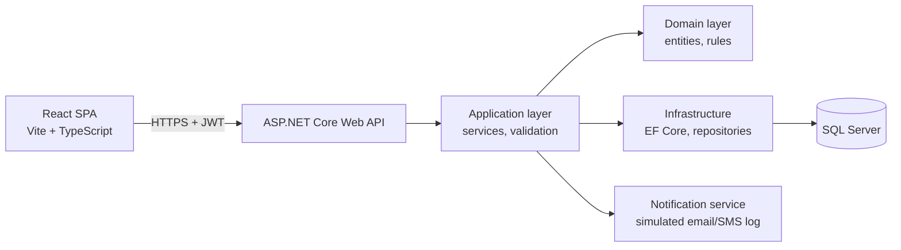

# Architecture

## Overview


## Solution layout
```
backend/
  LogistiCore.sln
  src/
    LogistiCore.Api/             Controllers, middleware, auth, Swagger
    LogistiCore.Application/     Services, DTOs, validators, interfaces
    LogistiCore.Domain/          Entities, enums, business rules
    LogistiCore.Infrastructure/  EF Core DbContext, migrations, repositories
  tests/
    LogistiCore.UnitTests/       xUnit + Moq (rules, services)
    LogistiCore.IntegrationTests/ WebApplicationFactory + test DB
frontend/
  src/ (api, components, features, hooks, pages, theme)
database/   SQL scripts (schema, seed, reports)
docs/
```

## Technology choices
| Concern | Choice | Reason |
|---|---|---|
| API | ASP.NET Core 8 Web API | Taught, industry standard |
| ORM | EF Core (code-first migrations) | Productivity; stored procedures for reports |
| DB | SQL Server | Required stack |
| Auth | JWT bearer + ASP.NET Core Identity password hasher, role policies | Stateless, simple |
| Validation | FluentValidation | Clear, testable rules |
| Barcode | ZXing.Net or BarcodeLib (Code128) | Server-side image |
| PDF | QuestPDF | Invoices/statements |
| Frontend | React + Vite + TypeScript, React Router, TanStack Query, React Hook Form + Zod | Modern and employable |
| UI kit | Own design tokens + Tailwind or MUI theme | Blue/pink brand |
| Tests | xUnit, Moq, FluentAssertions; Vitest + Testing Library | |
| CI | GitHub Actions | Build and test on every PR |

## Cross-cutting concerns
- **Error handling:** global exception middleware returns RFC 7807 `ProblemDetails`; validation errors map to 400 with field details.
- **Logging:** Serilog to console/file; no personal data in logs.
- **Security:** BCrypt/Identity hashing, `[Authorize(Roles=...)]` policies, CORS limited to the frontend origin, secrets via user-secrets/environment variables.
- **Transactions:** multi-step operations (assign route, generate invoice) run in a single `SaveChanges` transaction.
- **Config:** `appsettings.Development.json` is git-ignored; commit `appsettings.Example.json`.

## Key patterns
Layered/clean architecture, repository + unit of work (thin), service layer, DTO mapping, state machine for parcel status (see business rules).
